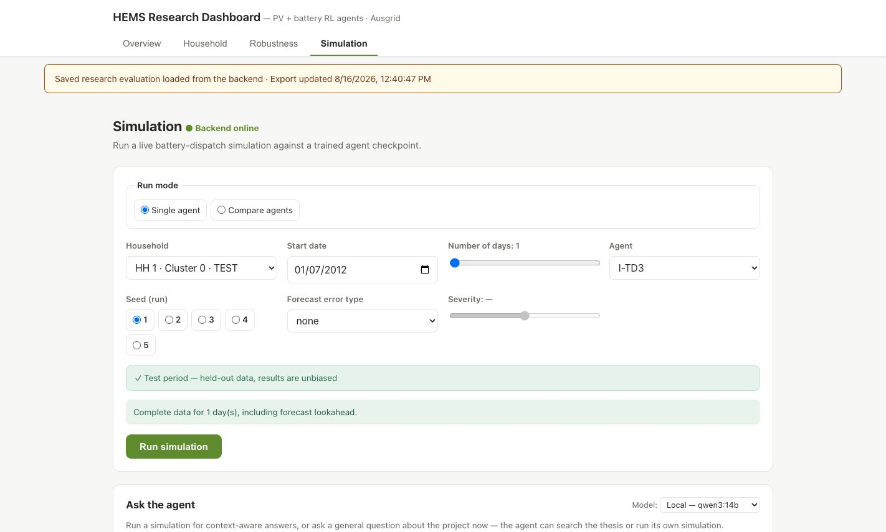
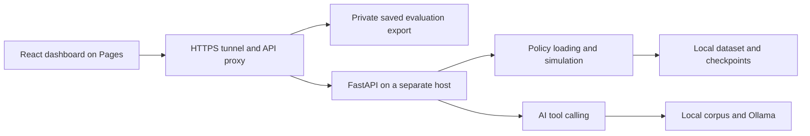

# Home Energy Management — RL and Simulation Code

A code-focused portfolio for battery-dispatch research: a custom reinforcement-learning environment, training/evaluation scripts, a FastAPI simulation service, an AI tool-calling interface and a React dashboard.

**Dashboard charts load saved research evaluation results from the backend through the HTTPS tunnel.** Thesis text, checkpoints, household datasets and measured evaluation exports stay on the backend host and are excluded from this repository. The frontend contains no bundled research results or sample chart fallback.

## Live demo

[Open the HEMS dashboard and simulation demo](https://stoem21.github.io/hems-rl-portfolio/)

The dashboard retrieves saved evaluation results from the live backend; simulation requests run on the research host. The dashboard and interactive features require the Mac backend and HTTPS tunnel to be online.



*Simulation setup screen before running an agent. Measured evaluation results are not embedded in this preview.*

| Area | Technologies |
| --- | --- |
| Dashboard | React 19, Vite, Recharts |
| API | Python, FastAPI, Pydantic |
| RL | PyTorch, Tianshou, Gymnasium; TD3, SAC and DDPG loading/training code |
| AI and retrieval | LangGraph, Ollama/optional provider adapter, local corpus retrieval and cache |
| Experiments | Training/evaluation utilities and MLflow integration |

## Run the dashboard

Requires Node.js 22 and access to a running backend. From the repository root, use the HTTPS API base supplied by the backend operator:

```bash
cd hems-frontend
npm ci
VITE_BACKEND_URL=https://YOUR-ASSIGNED-DOMAIN.ngrok-free.app/hems npm run dev
```

Replace the placeholder domain with the assigned ngrok domain. The API must allow the local frontend origin (normally `http://localhost:5173`) in its CORS configuration. Open the local URL printed by Vite; allow that exact origin if Vite selects another port. This runs the frontend against the configured API; it does not start Python inference or provide research assets.

For development with backends on the same machine, omit `VITE_BACKEND_URL` and run `npm run dev`. Vite forwards `/dashboard-data` to the combined proxy at `http://127.0.0.1:8787/hems/dashboard-data` and simulation/AI routes to FastAPI on port 8000. Configure and start those services first; see [combined proxy setup](ops/README.md) and [runtime inputs](docs/RUNTIME-INPUTS.md).

Without a working evaluation endpoint, the dashboard shows a connection error and an explicit retry button. It does not substitute generated results.

### Docker frontend preview

Requires Docker Desktop and the same running API. From the repository root, set the API URL **before building**:

```bash
VITE_BACKEND_URL=https://YOUR-ASSIGNED-DOMAIN.ngrok-free.app/hems docker compose up -d --build
```

Open `http://localhost:8180` and ensure that the API allows that origin. This image serves only the frontend; it does not start FastAPI, Ollama or model inference. The API URL is embedded at build time, so rebuild after changing it.

## Connect GitHub Pages to the backend

Set the repository variable `VITE_BACKEND_URL` to the assigned HTTPS ngrok origin plus `/hems`, then run the manual Pages deployment workflow. See [deployment](docs/DEPLOYMENT.md).

The combined proxy serves saved evaluation results at `GET /hems/dashboard-data` and forwards simulation and AI routes to FastAPI. The response identifies the configured export with a file modification timestamp and SHA-256; that timestamp is not the experiment execution date. Host configuration and private-export setup are documented in [combined proxy setup](ops/README.md) and [the saved evaluation endpoint](docs/DEPLOYMENT.md#saved-evaluation-endpoint).

## Architecture



## Inspect the code

- `hems-backend/hems_env.py`: environment, observations, battery dynamics and reward.
- `train.py` / `train_helper.py`: training pipeline and variants.
- `test.py` / `rescore_eval.py`: evaluation utilities; their inputs remain local.
- `hems-backend/simulation_service.py`: validation, rollout and comparisons.
- `hems-backend/rag_agent.py`: tool calling, retrieval and persistent embedding cache.
- `hems-frontend/src/lib/simulationStream.js`: simulation requests and streaming events.

Forecast variants are represented by `I-*`, `N-*`, `V-*` and `R-*` configurations. Displayed rankings and savings come from the configured saved evaluation export. Simulation runs are computed separately by FastAPI.

## Engineering highlights

- **Battery-dispatch environment:** A custom Gymnasium environment represents household demand, solar generation, battery state and dispatch rewards. Shared training utilities support TD3, SAC and DDPG configurations.
- **Validated simulation windows:** The FastAPI service checks household and agent selections, calendar dates, continuous half-hour measurements and forecast lookahead before a rollout. Missing intervals and incomplete measurements produce explicit errors.
- **Streaming results:** The React client handles fragmented UTF-8 server-sent events and preserves completed simulation results when an answer stream is interrupted. Comparison results remain tied to the same household and date window.
- **Runtime research assets:** The public source contains application and research pipeline code. Datasets, checkpoints, thesis retrieval material and measured evaluation exports remain on the host; the dashboard retrieves results through the API.
- **Request-conscious delivery:** Connection checks are shared and cached for five minutes, with no periodic health polling. A manual check supports reconnecting when the backend becomes available.

## My contribution

I developed this as a solo research and software project with AI coding assistance. My work covers the battery-dispatch RL environment, training and evaluation pipeline, FastAPI simulation service and React research dashboard.

For this public portfolio, I connected the dashboard to the live backend while keeping datasets, checkpoints, thesis material and measured exports on the research host. AI tools assisted with implementation, debugging, tests and documentation. Completed software checks are documented in the [validation scope](docs/VALIDATION.md).

## Validate without research data or model weights

```bash
python3 -m venv .venv
source .venv/bin/activate
pip install -r requirements-test.txt
pytest tests -q
```

```bash
cd hems-frontend
npm ci
node --test src/lib/simulationStream.test.js src/data/dashboardData.test.js src/hooks/useBackendHealth.test.cjs
node --test ../ops/tests/dashboard-data.test.cjs
npm run build
```

See [validation scope](docs/VALIDATION.md). Offline tests exercise application logic and mocked services. They do not reproduce training results, benchmark live model quality or establish agreement with thesis tables.

## Publication scope and attribution

`gen_dashboard_data.py` writes regenerated measured outputs under ignored `private-results/`; configure that private export path on the proxy to serve updated results. Ausgrid preprocessing code is included, while the dataset and measured exports remain outside this repository.

This repository does not include an open-source license for the application. Third-party packages retain their own licenses. The preprocessing pipeline targets Ausgrid Solar Home Electricity Data. See [Ausgrid's research data catalogue](https://www.ausgrid.com.au/about-us/about-ausgrid/research-data-sets) and the [dataset access notes](docs/RUNTIME-INPUTS.md#dataset-source).
