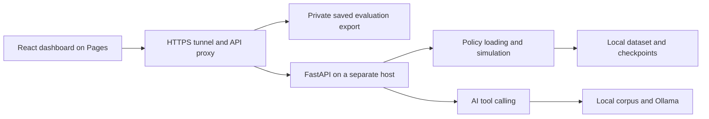

# Home Energy Management — RL and Simulation Code

A code-focused portfolio for battery-dispatch research: a custom reinforcement-learning environment, training/evaluation scripts, a FastAPI simulation service, an AI tool-calling interface and a React dashboard.

**Dashboard charts load saved research evaluation results from the backend through the HTTPS tunnel.** Thesis text, checkpoints, household datasets and measured evaluation exports stay on the Mac and are excluded from Git. The frontend contains no bundled research results or sample chart fallback.

| Area | Technologies |
| --- | --- |
| Dashboard | React 19, Vite, Recharts |
| API | Python, FastAPI, Pydantic |
| RL | PyTorch, Tianshou, Gymnasium; TD3, SAC and DDPG loading/training code |
| AI and retrieval | LangGraph, Ollama/optional provider adapter, local corpus retrieval and cache |
| Experiments | Training/evaluation utilities and MLflow integration |

## Run the dashboard

Requires Node.js 22:

```bash
cd hems-frontend
npm ci
npm run dev
```

Start the combined API proxy with its private evaluation export configured before opening the dashboard. In development, `/dashboard-data` is proxied to `http://127.0.0.1:8787/hems/dashboard-data`; simulation routes use FastAPI on port 8000. Without the export/API, the page shows a loading or connection error state with a retry button. It does not replace results with generated values.

A Docker alternative is available from the repository root:

```bash
docker compose up -d --build
```

Set `VITE_BACKEND_URL` in the build environment to the combined HTTPS API base, then open `http://localhost:8180`. This Docker image builds only the frontend and does not copy research assets or start Python inference.

## Connect the live backend

Set the public build variable:

```text
VITE_BACKEND_URL=https://YOUR-ASSIGNED-DOMAIN.ngrok-free.app/hems
```

The combined Mac proxy serves `GET /hems/dashboard-data` from the private file selected by `hemsDashboardDataFile` in its local configuration. Use the existing generated `hems-frontend/src/data/dashboardData.js` on the research host, or an updated export from `gen_dashboard_data.py`. Only an operator-owned, trusted export should be configured: JavaScript exports are loaded as modules. The response includes export modification time and SHA-256; metric values are passed through unchanged. This identifies the saved export, without independently verifying thesis agreement.

The proxy forwards `/hems/simulate`, `/hems/simulate/compare`, `/hems/ask` and related API calls to FastAPI. Runtime data, checkpoints and thesis retrieval stay on the Mac. See [deployment](docs/DEPLOYMENT.md) and [runtime inputs](docs/RUNTIME-INPUTS.md).

## Architecture



## Inspect the code

- `hems-backend/hems_env.py`: environment, observations, battery dynamics and reward.
- `train.py` / `train_helper.py`: training pipeline and variants.
- `test.py` / `rescore_eval.py`: evaluation utilities; their inputs remain local.
- `hems-backend/simulation_service.py`: validation, rollout and comparisons.
- `hems-backend/rag_agent.py`: tool calling, retrieval and persistent embedding cache.
- `hems-frontend/src/lib/simulationStream.js`: simulation requests and streaming events.

Forecast variants are represented by `I-*`, `N-*`, `V-*` and `R-*` configurations. Displayed rankings and savings come from the configured saved evaluation export. Simulation runs are computed separately by FastAPI; thesis consistency requires comparison with the thesis tables and experiment settings.

## Validate without research data or model weights

```bash
python3 -m venv .venv
source .venv/bin/activate
pip install -r requirements-test.txt
pytest tests -q
```

```bash
cd hems-frontend
npm ci
node --test src/lib/simulationStream.test.js src/data/dashboardData.test.js
node --test ../ops/tests/dashboard-data.test.cjs
npm run build
```

See [validation scope](docs/VALIDATION.md). Offline tests exercise application logic and mocked services; they do not reproduce training results or benchmark live model quality.

## Publication scope and attribution

Research artifacts are intentionally excluded. `gen_dashboard_data.py` writes regenerated measured outputs under ignored `private-results/`, keeping measured values out of the frontend source bundle. Configure that private export path on the proxy to serve updated results at runtime. Ausgrid preprocessing code is included; dataset distribution is not.

Third-party packages retain their own licenses. No open-source licensing or personal authorship statement is selected automatically; the owner should review those before publication.
